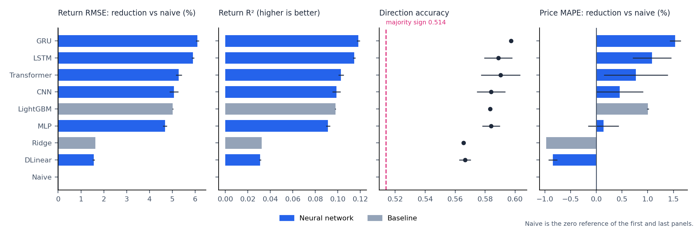
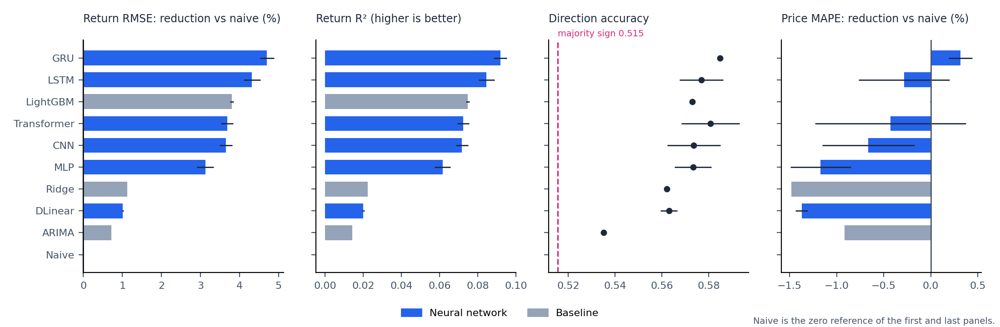
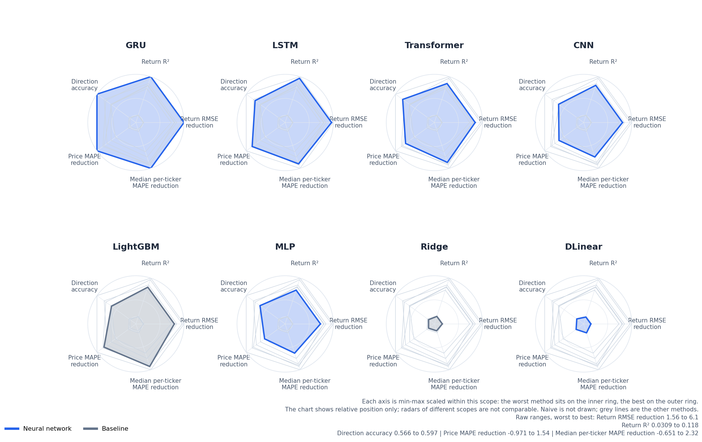
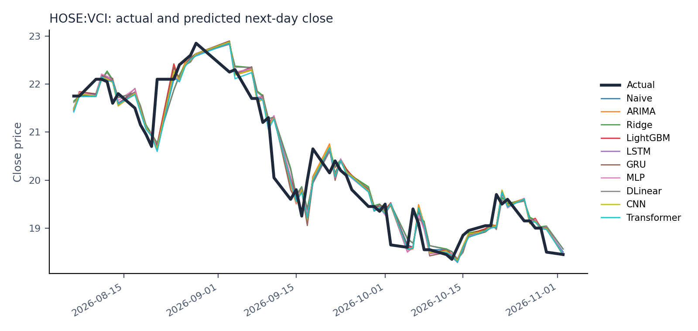
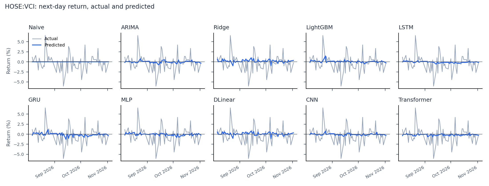

# BUF

BUF benchmarks ten methods that forecast the next recorded day's log return of Vietnamese stocks (HNX, HOSE, UPCOM) from the last 50 days, on a chronological split. The repository also holds a Gradio demo of a pretrained LSTM, which is not validated for forecasting.

Read the documents in this order:

| Order | Document | Covers |
|---|---|---|
| 1 | [`docs/PROBLEM.md`](docs/PROBLEM.md) | The task, the data and the split |
| 2 | [`docs/METHODS.md`](docs/METHODS.md) | The ten methods, each with its own figure |
| 3 | [`docs/METRICS.md`](docs/METRICS.md) | The scores and how to read them |
| 4 | [`docs/RESULTS.md`](docs/RESULTS.md) | The numbers behind the reading, and the checks |
| 5 | [`docs/INDEX.md`](docs/INDEX.md) | Concepts mapped to code, files and run options |

## Benchmark results

Test period 1 June 2023 to 2 November 2026 (724,798 samples). Rows are sorted by return RMSE; lower is better for the RMSE and MAPE columns, higher for R² and direction accuracy. Neural networks and LightGBM: mean over seeds 0, 1 and 2; the other methods have one run. The standard deviation over seeds is shown for return RMSE.

**Full test split**

| Method | Return RMSE (mean ± std) | Return R² | Direction acc. | Price RMSE | Price MAPE | Median per-ticker MAPE |
|---|---:|---:|---:|---:|---:|---:|
| GRU | 0.03915 ± 0.00003 | 0.118 | 0.597 | 1.180 | 0.0233 | 0.0243 |
| LSTM | 0.03923 ± 0.00002 | 0.115 | 0.589 | 1.180 | 0.0234 | 0.0244 |
| Transformer | 0.03949 ± 0.00005 | 0.103 | 0.590 | 1.190 | 0.0235 | 0.0244 |
| CNN | 0.03958 ± 0.00008 | 0.099 | 0.584 | 1.190 | 0.0236 | 0.0245 |
| LightGBM | 0.03960 ± 0.00001 | 0.098 | 0.583 | 1.187 | 0.0234 | 0.0244 |
| MLP | 0.03974 ± 0.00004 | 0.091 | 0.584 | 1.192 | 0.0236 | 0.0246 |
| Ridge | 0.04101 | 0.032 | 0.566 | 1.237 | 0.0239 | 0.0251 |
| DLinear | 0.04104 ± 0.00002 | 0.031 | 0.567 | 1.238 | 0.0239 | 0.0250 |
| Naive | 0.04169 | 0.000 | n/a | 1.264 | 0.0237 | 0.0249 |

**90-stock subset** (the only scope that includes ARIMA; 89 of the 90 stocks have test samples, HNX:TTZ has none)

| Method | Return RMSE (mean ± std) | Return R² | Direction acc. | Price RMSE | Price MAPE | Median per-ticker MAPE |
|---|---:|---:|---:|---:|---:|---:|
| GRU | 0.03565 ± 0.00007 | 0.092 | 0.585 | 1.061 | 0.0216 | 0.0209 |
| LSTM | 0.03579 ± 0.00008 | 0.085 | 0.577 | 1.071 | 0.0217 | 0.0210 |
| LightGBM | 0.03599 ± 0.00002 | 0.075 | 0.573 | 1.088 | 0.0216 | 0.0215 |
| Transformer | 0.03603 ± 0.00006 | 0.072 | 0.581 | 1.099 | 0.0217 | 0.0210 |
| CNN | 0.03604 ± 0.00006 | 0.072 | 0.574 | 1.085 | 0.0218 | 0.0211 |
| MLP | 0.03624 ± 0.00008 | 0.062 | 0.573 | 1.093 | 0.0219 | 0.0213 |
| Ridge | 0.03699 | 0.022 | 0.562 | 1.119 | 0.0220 | 0.0220 |
| DLinear | 0.03703 ± 0.00001 | 0.020 | 0.563 | 1.118 | 0.0219 | 0.0219 |
| ARIMA(1,0,1) | 0.03714 | 0.014 | 0.535 | 1.095 | 0.0218 | 0.0224 |
| Naive | 0.03741 | 0.000 | n/a | 1.123 | 0.0216 | 0.0222 |

<p align="center">
  
  <br><em>Figure 1. Full test split. Error metrics are shown as the percentage reduction against naive; direction accuracy as dots against the majority-sign reference. Error bars are the standard deviation over seeds.</em>
</p>

<p align="center">
  
  <br><em>Figure 2. The 90-stock subset, which includes ARIMA, with its own majority-sign reference.</em>
</p>

<p align="center">
  
  <br><em>Figure 3. The same scores as one radar per method (full test split; subset: <a href="docs/figures/radar_subset_test.png">docs/figures/radar_subset_test.png</a>). Each axis is min-max scaled within its scope, so the chart shows relative position only. Radars of different scopes are not comparable.</em>
</p>

**Reading the results**

- Every learned method has a lower return RMSE than naive. The GRU reduction is 6.0% on seed 0, and LSTM is almost the same (Results §1).
- Direction accuracy is read against the majority-sign reference of 51.4% on the full test split (51.5% on the subset) (Metrics §3). The strong scores have been checked only in part (Results §6).

**Example predictions.** HOSE:VCI over its last 60 trading days, from seed 0 of the main run (Results §9).

<p align="center">
  
  <br><em>Figure 4. Actual close (thick line) and each method's predicted next-day close. The lines nearly coincide and trail the actual line by one day.</em>
</p>

<p align="center">
  
  <br><em>Figure 5. Predicted (blue) against actual (grey) next-day return. The learned methods predict small returns that miss the large moves; naive predicts zero.</em>
</p>

Caveats on heavy tails, data coverage, duplicated tickers and the training budget are in [`docs/RESULTS.md`](docs/RESULTS.md) and [`docs/PROBLEM.md`](docs/PROBLEM.md).

**Demo.** The demo LSTM predicts the next day's open, close, high and low. On the earlier data it was trained on, its close error was far larger than naive's, and it has not been re-evaluated. Do not use it for decisions (Problem §6, Results §10).

## Run

```bash
pip install -r requirements.txt
python -m scripts.benchmark --data data --out results
python app.py
```

Options, output files and memory requirements are in [`docs/INDEX.md`](docs/INDEX.md).
