# Methods

This document describes the ten methods compared on the task defined in the [Problem document](PROBLEM.md): four baselines and six neural networks. Scores are defined in the [Metrics document](METRICS.md). Source code and run commands are out of scope here.

## 1. Shared setup

Figure 1 gives the pipeline.

  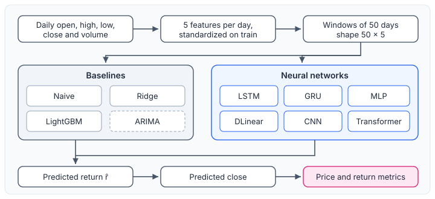
   <em>Figure 1. Benchmark pipeline. Every method uses the same date boundaries and predicts the same target; ARIMA is evaluated only on the 90-stock subset. ARIMA, drawn dashed, is the exception in its input: it is fitted separately for each stock and reads only the return series, carrying its state forward from the start of the series rather than using a 50-day window.</em>

- **Input.** A window of the last 50 days, each described by five features ([Problem document](PROBLEM.md), §2). Each feature is standardized with its mean and standard deviation on the training split. The input has shape $50 \times 5$; Ridge, LightGBM and the MLP read it flattened into 250 values.
- **Target.** The next-day log return, divided by the standard deviation of the training returns (not centered). Predictions are multiplied back before scoring.
- **Price.** $\hat C_t = C_{t-1}\, e^{\hat r_t}$.
- **Seeds.** Methods with random elements are run with seeds 0, 1 and 2.

## 2. Baselines

### 2.1 Naive

Naive predicts no change, so its forecast price is the previous close.

  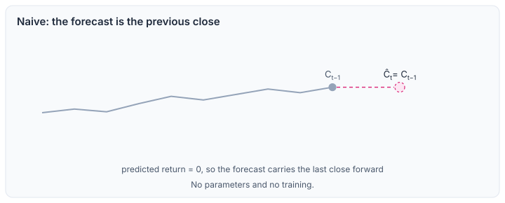
   <em>Figure 2. Naive forecast. The predicted return is zero, so the predicted close equals the previous close.</em>

- Predicted return $\hat r_t = 0$. No parameters and no training.

### 2.2 ARIMA(1,0,1)

ARIMA models the return series alone, one model per stock.

  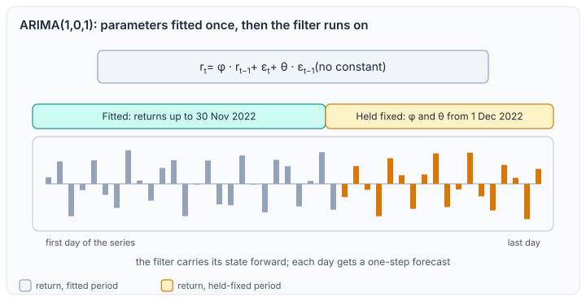
   <em>Figure 3. ARIMA(1,0,1). The parameters are fitted on the training part of the series and then held fixed; the filter runs over the whole series, so each day gets a one-step forecast.</em>

- Model $r_t = \varphi\, r_{t-1} + \varepsilon_t + \theta\, \varepsilon_{t-1}$, with no constant (Box and Jenkins, 1976).
- The parameters are estimated on the returns up to 30 November 2022 and then held fixed.
- The model then filters the whole series and predicts each day one step ahead.
- Run on the 90-stock subset only.

### 2.3 Ridge

Ridge is a linear regression on the flattened window with an L2 penalty.

  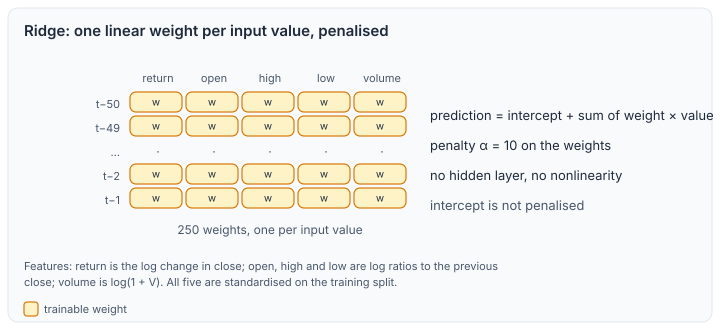
   <em>Figure 4. Ridge. One weight per input value; the prediction is a weighted sum plus an intercept, and the weights are penalised. The grid is schematic.</em>

- Objective $\hat\beta = \arg\min \lVert y - X\beta \rVert^2 + \alpha \lVert \beta \rVert^2$ with an intercept that is not penalised (Hoerl and Kennard, 1970).
- Penalty $\alpha = 10$ on the 250 flattened features.

### 2.4 LightGBM

LightGBM is a gradient-boosted tree ensemble on the flattened window (Ke et al., 2017).

  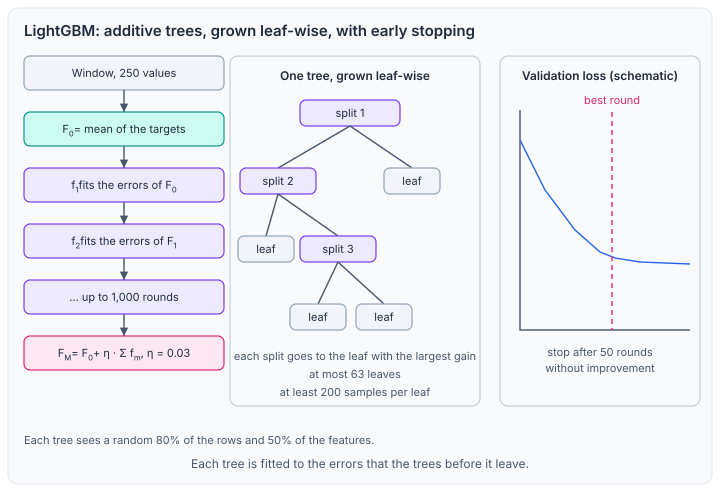
   <em>Figure 5. LightGBM. Each tree is fitted to the errors of the trees before it. The tree and the validation curve are schematic, not fitted to the data.</em>

- Squared-error objective, learning rate 0.03, at most 63 leaves per tree, at least 200 samples per leaf.
- For each tree, 80% of the rows and 50% of the features are drawn at random.
- At most 1,000 rounds; training stops after 50 rounds without improvement on the validation set.

## 3. Neural networks

All six networks read the same $50 \times 5$ window and produce one return. They use 64 units wherever a width is given. Except DLinear, each begins with batch normalization (Ioffe and Szegedy, 2015) that treats each of the 50 time positions as one channel, normalizing it over the batch and the five features, with running statistics at inference. Hidden dense layers use SiLU (Elfwing et al., 2018) and the output layer is linear. Figure 6 gives an overview; each method then has its own figure.

  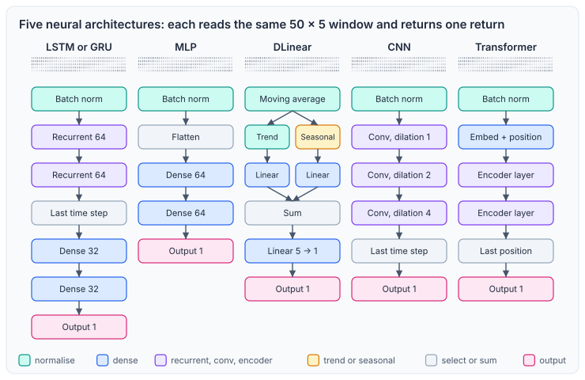
   <em>Figure 6. Architectures at a glance, coloured as in the legend. Blue blocks are dense layers, violet blocks are recurrent, convolution or encoder layers, and the pink block is the single output.</em>

### 3.1 LSTM and GRU

The two recurrent networks share one layout and differ only in the unit.

  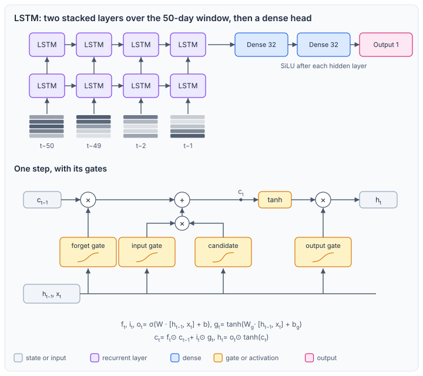
   <em>Figure 7. LSTM. Two stacked layers unrolled over the window and the dense head. Below, the gates and the cell state of one step.</em>

  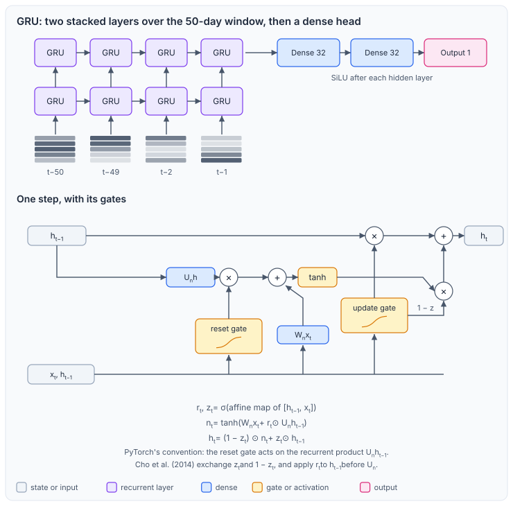
   <em>Figure 8. GRU. The same layout with gated recurrent units. Below, one step with the reset gate acting on the recurrent product and the update gate mixing the candidate with the previous state, in PyTorch's convention.</em>

- Two stacked recurrent layers of 64 units each (Hochreiter and Schmidhuber, 1997; Gers et al., 2000; Cho et al., 2014), with no dropout between them.
- The GRU follows PyTorch's convention: the reset gate multiplies the recurrent product, and $h_t = (1 - z_t) \odot n_t + z_t \odot h_{t-1}$. Cho et al. (2014) write the same update with $z_t$ and $1 - z_t$ exchanged, and apply the reset gate to the previous state before $U$, that is $U(r_t \odot h_{t-1})$, so the reset placement differs.
- The last time step feeds dense layers of 32, 32 and 1 unit, with SiLU after the two hidden layers.

### 3.2 MLP

  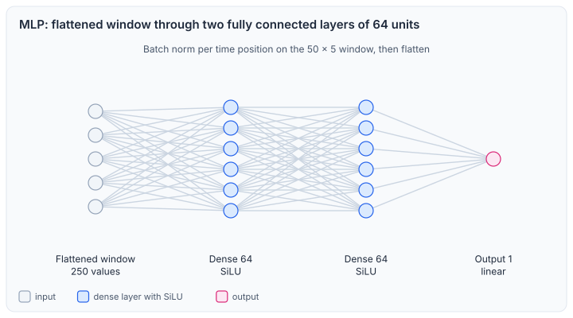
   <em>Figure 9. MLP. The flattened window passes through two hidden layers of 64 units.</em>

- The flattened window feeds dense layers of 64, 64 and 1 unit, with SiLU after the two hidden layers.

### 3.3 DLinear

DLinear splits each feature series into a trend and a seasonal part and applies linear maps to each part (Zeng et al., 2023).

  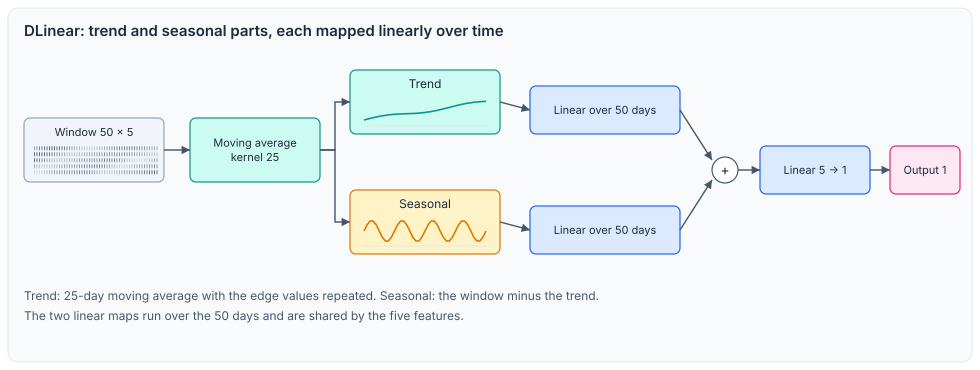
   <em>Figure 10. DLinear. A moving average splits the window into a trend and a seasonal part (the rest of the window); each part is mapped linearly over time, the two are summed, and the sum is mapped over the features.</em>

- Trend: moving average over 25 days, with the edge values repeated at both ends. Seasonal: window minus trend, which is the remainder after the trend.
- One linear map over the 50 time steps is applied to each part, shared across the five features.
- The sum is mapped to one value by a linear layer over the five features. No batch normalization.
- Adapted from the original: this version predicts one step and mixes the features in the last layer, whereas the original treats each feature series independently.

### 3.4 CNN

  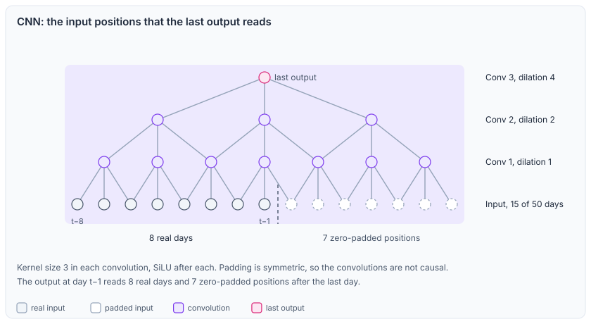
   <em>Figure 11. CNN. The receptive field of the last output: each layer reads the taps of its dilation, so the last output reads 15 input positions. Padding is on both sides, so 7 of them are zero padding after the last real day.</em>

- Three one-dimensional convolutions with 64 channels, kernel size 3 and dilations 1, 2 and 4 (Yu and Koltun, 2016), each followed by SiLU.
- Zero padding on both sides keeps the length, so the convolutions are not causal. The last output reads 15 positions: 8 real days and 7 padded positions after the last day.
- A linear layer reads the last output position.

### 3.5 Transformer

  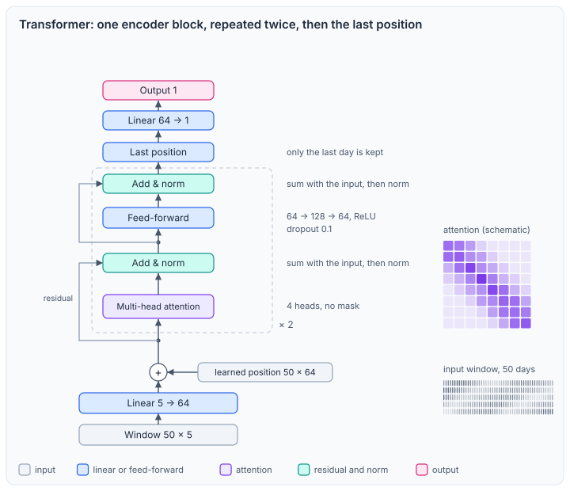
   <em>Figure 12. Transformer. One encoder block, repeated twice (N = 2): 4-head attention and a feed-forward sublayer with ReLU, each followed by a residual sum and normalization (post-norm).</em>

- Each day is projected to 64 dimensions and added to a learned position embedding.
- Two encoder layers (Vaswani et al., 2017), each with 4 attention heads of 16 dimensions and no attention mask, so every position attends to all 50 days.
- Normalization comes after each residual sum (post-norm). The feed-forward block has width 128 with ReLU. Dropout of 0.1 is applied to the attention weights, to the attention output, inside the feed-forward block after the ReLU, and to the feed-forward output (the placements of PyTorch's encoder layer).
- A linear layer reads the last position.

**Training.** The same procedure is used for all networks: the Adam optimizer (Kingma and Ba, 2015) with learning rate $10^{-3}$, batches of 2048 samples, mean squared error on the scaled target, gradient-norm clipping at 1.0, and at most 6 epochs. The validation loss is evaluated after each epoch; the weights of the best epoch are kept, and training stops after 3 epochs without improvement. Whether the epoch and round limits were reached is reported in the [Results document](RESULTS.md), §7.

## References

- Box, G. E. P. and Jenkins, G. M. (1976). *Time Series Analysis: Forecasting and Control*. Holden-Day.
- Cho, K., van Merriënboer, B., Gulcehre, C., Bahdanau, D., Bougares, F., Schwenk, H. and Bengio, Y. (2014). Learning phrase representations using RNN encoder–decoder for statistical machine translation. *EMNLP*.
- Elfwing, S., Uchibe, E. and Doya, K. (2018). Sigmoid-weighted linear units for neural network function approximation in reinforcement learning. *Neural Networks*, 107, 3–11.
- Gers, F. A., Schmidhuber, J. and Cummins, F. (2000). Learning to forget: continual prediction with LSTM. *Neural Computation*, 12(10), 2451–2471.
- Hochreiter, S. and Schmidhuber, J. (1997). Long short-term memory. *Neural Computation*, 9(8), 1735–1780.
- Hoerl, A. E. and Kennard, R. W. (1970). Ridge regression: Biased estimation for nonorthogonal problems. *Technometrics*, 12(1), 55–67.
- Ioffe, S. and Szegedy, C. (2015). Batch normalization: Accelerating deep network training by reducing internal covariate shift. *ICML*.
- Ke, G., Meng, Q., Finley, T., Wang, T., Chen, W., Ma, W., Ye, Q. and Liu, T.-Y. (2017). LightGBM: A highly efficient gradient boosting decision tree. *NeurIPS*.
- Kingma, D. P. and Ba, J. (2015). Adam: A method for stochastic optimization. *ICLR*.
- Vaswani, A., Shazeer, N., Parmar, N., Uszkoreit, J., Jones, L., Gomez, A. N., Kaiser, Ł. and Polosukhin, I. (2017). Attention is all you need. *NeurIPS*.
- Yu, F. and Koltun, V. (2016). Multi-scale context aggregation by dilated convolutions. *ICLR*.
- Zeng, A., Chen, M., Zhang, L. and Xu, Q. (2023). Are transformers effective for time series forecasting? *AAAI*.
