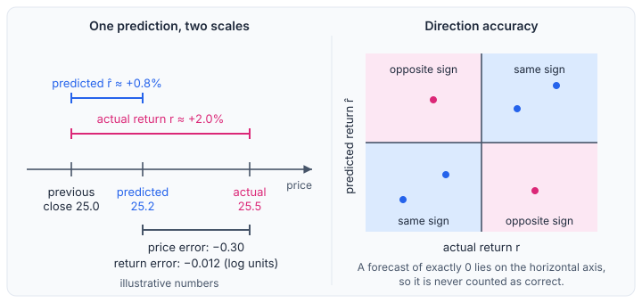

# Metrics

## 1. Notation

For each test sample, $C_{t-1}$ is the previous close, $C_t$ the actual close, $r_t = \ln(C_t / C_{t-1})$ the actual return and $\hat r_t$ the predicted return. The predicted close is $\hat C_t = C_{t-1}\, e^{\hat r_t}$. $N$ is the number of samples in the scope being scored.

A forecast has two readings. The price reading compares $\hat C_t$ with $C_t$; the return reading compares $\hat r_t$ with $r_t$. Figure 1 shows one prediction on both scales and the geometry of direction accuracy.

  
   <em>Figure 1. Left: one illustrative prediction, its price error and its return error. Right: direction accuracy counts the samples that fall in the two same-sign quadrants.</em>

## 2. Price metrics

| Metric | Definition |
|---|---|
| Price RMSE | $\sqrt{\frac{1}{N}\sum (\hat C_t - C_t)^2}$ |
| Price MAPE | $\frac{1}{N}\sum \frac{\lvert \hat C_t - C_t \rvert}{\lvert C_t \rvert}$, a fraction (0.02 means 2%) |
| Median per-ticker MAPE | The MAPE of each ticker, then the median over tickers |
| Price $R^2$ | $1 - \frac{\sum (\hat C_t - C_t)^2}{\sum (C_t - \bar C)^2}$, pooled over all tickers |

- RMSE is in price units, so high-priced tickers dominate it.
- MAPE gives every sample the same weight; the median per-ticker MAPE gives every ticker the same weight, whatever its number of samples (Hyndman and Koehler, 2006).
- Price $R^2$ is close to 1 for every method, because the variance of prices across tickers is far larger than any forecast error. It is useful only to detect a broken model and should not be used to rank methods.

## 3. Return metrics

These are the main metrics, because the task target is the return.

| Metric | Definition |
|---|---|
| Return RMSE | $\sqrt{\frac{1}{N}\sum (\hat r_t - r_t)^2}$ |
| Return $R^2$ | $1 - \frac{\sum (\hat r_t - r_t)^2}{\sum (r_t - \bar r)^2}$ |
| Direction accuracy | The share of samples with $\mathrm{sign}(\hat r_t) = \mathrm{sign}(r_t)$ |

- Return $R^2$ measures the gain over always predicting the mean test return. A value near 0 means no gain and a negative value means a loss. The naive forecast scores just below 0.
- Samples with $r_t = 0$ are excluded from direction accuracy. A forecast of exactly 0 never has a sign that matches, so the naive forecast scores 0 by construction; it should be compared with the other methods only through the other metrics. Samples with an unchanged close are therefore not scored (21.4% of the test returns). A balanced random guess scores about 0.5, but the proper reference is the majority-sign guess: if a share $p$ of the non-zero returns is positive, always predicting the more frequent sign scores $\max(p, 1-p)$. On the full test split $p$ is 48.6%, so that reference is 51.4%; on the 90-stock subset $p$ is 48.5% and the reference is 51.5%. Both references are computed on the test set after the fact, so they are reference accuracies, not baselines fitted on the training data.

## 4. Aggregation

- **Scopes.** Each metric is computed separately on the full test split and on the 90-stock subset. ARIMA is reported on the subset only. Scores from the two scopes are not comparable, since they contain different stocks.
- **Seeds.** For methods run with several seeds, each seed is scored separately, and the table reports the mean and the sample standard deviation over seeds. Methods without randomness have no standard deviation.

## 5. Interpretation

- Compare every method with the naive forecast on the same scope. The primary metric is return RMSE, since it measures the error of the quantity being predicted; the other metrics are read as supporting evidence. Price RMSE and price MAPE can rank methods differently, because RMSE is dominated by high-priced tickers and MAPE weights every sample equally, so both are reported.
- The standard deviation over seeds reflects training randomness only; it does not include the sampling noise of the test set.
- Differences between methods are reported as point values. No interval or formal test is computed, so small differences should not be over-read.
- Because daily returns are small and noisy, return $R^2$ values are expected to be small.
- Direction accuracy is meaningful only relative to the majority-sign reference above; exceeding it is necessary but not sufficient evidence of skill, and it ignores the size of the error, so it should be read together with the return RMSE.

## References

- Hyndman, R. J. and Koehler, A. B. (2006). Another look at measures of forecast accuracy. *International Journal of Forecasting*, 22(4), 679–688.
