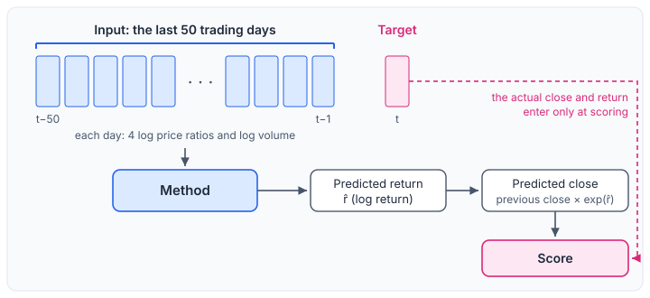
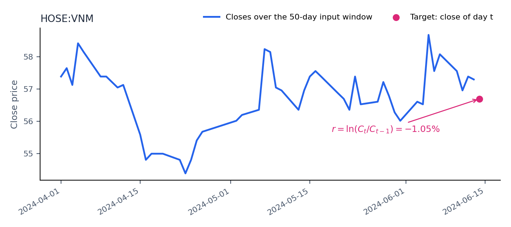
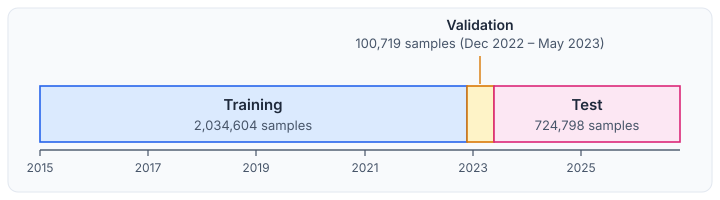

# One-Step-Ahead Forecasting of Vietnamese Stock Prices

## 1. Task

Given the recent history of one stock listed on the Hanoi (HNX), Ho Chi Minh City (HOSE) or UPCOM exchange, predict its closing price on the next recorded trading day. This is usually the next exchange session, but not always (§3). The forecast is made after the close of day $t-1$ and may use only information available up to that close. Figure 1 shows the setting; the actual close and return enter only at scoring.

  
   <em>Figure 1. The task. A method reads the last 50 trading days and predicts the next-day return, which is converted to a price. The actual close and return are never given to the method; they meet the prediction only at the scoring step.</em>

## 2. Formal definition

For one stock, let $O_t, H_t, L_t, C_t$ and $V_t$ be the open, high, low, close and volume of trading day $t$. The window length is $W = 50$.

| Item | Definition |
|---|---|
| Day features | $x_t = \big(\ln\frac{C_t}{C_{t-1}},\ \ln\frac{O_t}{C_{t-1}},\ \ln\frac{H_t}{C_{t-1}},\ \ln\frac{L_t}{C_{t-1}},\ \ln(1+V_t)\big)$ |
| Input | $X_t = (x_{t-W}, \dots, x_{t-1}) \in \mathbb{R}^{W \times 5}$ |
| Target | The next-day log return $r_t = \ln\frac{C_t}{C_{t-1}}$ |
| Prediction | A predicted return $\hat r_t = f(X_t)$ |
| Predicted close | $\hat C_t = C_{t-1}\, e^{\hat r_t}$ |

Each sample is one pair of a stock and a predicted day $t$. A stock with $n$ trading days yields $n - 51$ samples: the first day has no previous close, the window needs 50 days of features, and the predicted day needs one more.

Predicting the return rather than the price removes the price level, which differs by orders of magnitude between stocks and over time. The predicted return is converted back to a price so that methods can be scored on both scales ([Metrics document](METRICS.md)). Figure 2 shows one real sample.

  
   <em>Figure 2. One real sample (HOSE: VNM). The blue line shows the closes over the 50-day input window and the pink point is the target day. The method reads the five features of §2 computed from these days, not the prices themselves.</em>

## 3. Data

The data are daily price tables, one per ticker, with the open, high, low, close and volume of each trading day.

| Exchange | Tickers | Rows |
|---|---|---|
| HNX | 294 | 721,576 |
| HOSE | 382 | 1,021,584 |
| UPCOM | 661 | 1,185,148 |
| Total | 1,337 | 2,928,308 |

- **Period:** 5 January 2015 to 2 November 2026. The shortest series has 415 rows.
- **Filter:** series with fewer than 300 rows are discarded. No current series is affected.
- **Duplicates:** eight tickers have identical files under two exchanges. They are kept once, under the first exchange of the order HOSE, HNX, UPCOM, so their exchange label is not verified. The tables above count each ticker once.
- **Samples:** 2,860,121 in total.
- **Coverage:** only the tickers present in the tables are covered, so stocks delisted before the data were collected may be missing (survivorship bias). The number of tickers with data per year rises from 782 in 2015 to about 1,330 in 2019 and then declines slowly to 1,283 in 2026. After 2021 the tables hold fewer rows per ticker per year (about 250 in 2020 against about 170 in 2024), so a 50-row window spans more calendar time in later years.
- **Gaps between observations:** the target is the next recorded day of a stock, which is not always the next exchange session. In the test split, 69.7% of targets follow the previous recorded day by one calendar day, 20.6% by two or three days (a weekend), 2.4% by four days, 4.7% by five to seven days and 2.6% by more than seven days. The 7.3% of targets that follow a gap of more than four days may span several sessions or reflect missing data; the two cases cannot be told apart from the tables, and the benchmark does not treat them separately.
- **Unchanged closes:** 21.4% of the test returns are exactly zero, the close being unchanged from the previous recorded day. Among the non-zero returns, 48.6% are positive.
- **Adjustment:** prices are used as stored, in the units of the tables; the quotation unit is not documented. The source of the data and its treatment of splits and dividends are not documented here.

## 4. Evaluation protocol

**Chronological split.** One global date cutoff is applied to the date of the predicted day, so no test day precedes a training day. Figure 3 shows the three periods.

  
   <em>Figure 3. Chronological split, drawn to scale in calendar time. The cutoffs are dates of the predicted day. Sample shares differ from time shares because the number of rows per ticker per year differs between periods (§3).</em>

| Split | Predicted days | Samples |
|---|---|---|
| Training | up to 30 November 2022 | 2,034,604 |
| Validation | 1 December 2022 to 31 May 2023 | 100,719 |
| Test | from 1 June 2023 | 724,798 |

**Use of each split.** The training split fits parameters and the standardization statistics (feature means and standard deviations, and the scale of the returns). The validation split is used for early stopping and for choosing the best epoch or boosting round. The test split is used only for the final scores.

**Scopes.** Every method is scored on the full test split, except ARIMA. ARIMA is fitted separately for each stock and is run only on a random subset of 30 stocks per exchange, 90 in total, with 52,472 test samples. 89 of the 90 stocks have test samples. The other, HNX:TTZ, has its last recorded day on 2 December 2022, before the test period. All methods are also scored on this subset so that ARIMA can be compared with them.

**Seeds.** Methods with random initialization or sampling (LightGBM and the neural networks) are run with three seeds. Scores are reported as the mean and standard deviation over seeds.

## 5. Reference forecast

The naive forecast predicts $\hat r_t = 0$, that is, tomorrow's close equals today's. It is the random-walk benchmark of the forecasting literature (Meese and Rogoff, 1983) and is the reference for every other method: a method that does not improve on it under the primary return metric ([Metrics document](METRICS.md)) has not been shown to add anything over "same as today".

## 6. Limitations

- Only the one-recorded-observation-ahead horizon is considered (the elapsed time between observations varies), and no trading rule, transaction cost or portfolio is modelled.
- Very large returns are not necessarily ordinary one-day moves. Among test returns of more than 50% in absolute value, all follow a gap of more than four days between recorded days and only 12% are reversed by at least half on the next day; among those above 20%, 63% follow such a gap. Their causes remain undetermined and may include multi-session movements, missing observations, corporate actions or data errors. No adjustment is applied.
- Prices are not checked for corporate actions. An unadjusted split or a change of units appears as a very large return.
- The demo model, which predicts open, high, low and close from raw prices, is a separate formulation and is not part of the benchmark. Its weights come from an earlier model that was trained on an earlier version of the price tables, and which of the demo's predictions are in-sample is not documented. On that earlier data, its next-day close error on the stocks checked was much larger than the naive forecast's. It has not been re-evaluated on the current data and should not be used for decisions.

## References

- Meese, R. A. and Rogoff, K. (1983). Empirical exchange rate models of the seventies: Do they fit out of sample? *Journal of International Economics*, 14(1–2), 3–24.
